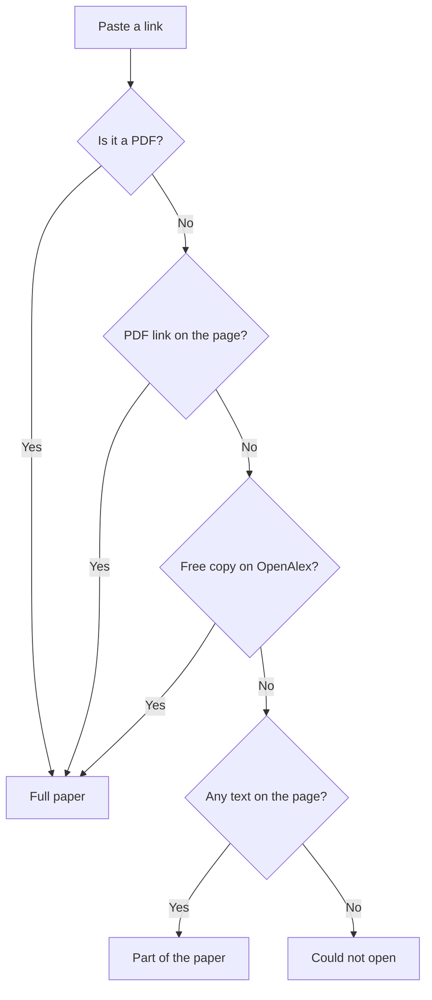

# Paper Explainer

*Personal project*

**Live demo:** https://paper-explainer.streamlit.app

Reading a full research paper is hard and takes a lot of time. So I made this small app. You give it a paper and it explains it in simple words. Then you can ask it anything about the paper.

> The app may be sleeping if no one used it for a while. Just click "Wake up" and wait a few seconds.

## What it does

- You can give a paper in 3 ways: paste a link, upload a PDF, or type the paper's name
- It tells you how much of the paper it could open:
  - Full paper
  - Only part of it (like the abstract), because the full paper is paid
  - Could not open it at all
- It explains the paper: what it is about, the problem, how they solved it, the results and the weak points
- You can pick the level: Beginner, Student or Expert
- You can ask questions in the chat. Every answer says if it came from the paper or from general knowledge
- It replies in English, but if you write in Roman Urdu it replies in Roman Urdu

## How it finds the paper

When you paste a link, the app tries these steps one by one:

## Built with

| Part | Tool |
|---|---|
| Language | Python |
| Web page | Streamlit |
| AI | Google Gemini API (free tier) |
| Reading PDFs | PyMuPDF |
| Opening links | Requests, BeautifulSoup |
| Finding free papers | OpenAlex, arXiv |

---

Built by Hassaan
